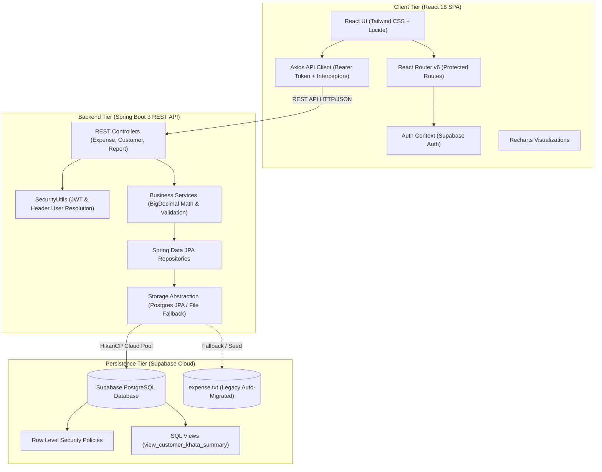

# 🐮 Pashu Aahar & Dairy Khata | Smart Expense & Customer Ledger

[](https://react.dev/)
[](https://spring.io/projects/spring-boot)
[](https://supabase.com/)
[](https://tailwindcss.com/)
[](LICENSE)

An enterprise-grade, full-stack personal finance and commercial customer ledger application. Designed for **Cattle Feed (Pashu Aahar) suppliers, Dairy businesses, and general commerce**, this solution combines high-precision financial tracking, customer credit (*Udhaar / Khata*) management, multi-mode payment settlements, and interactive analytical dashboards.

---

## 📑 Table of Contents

- [Key Features](#-key-features)
- [Architecture & Design](#-architecture--design)
- [Technology Stack](#-technology-stack)
- [Directory Structure](#-directory-structure)
- [Prerequisites](#-prerequisites)
- [Environment Configuration](#-environment-configuration)
- [Database Setup & Migrations](#-database-setup--migrations)
- [How to Run](#-how-to-run)
  - [Option A: One-Click Startup (Recommended)](#option-a-one-click-startup-recommended)
  - [Option B: Manual Terminal Startup](#option-b-manual-terminal-startup)
- [REST API Reference](#-rest-api-reference)
  - [1. Expenses API (`/api/expenses`)](#1-expenses-api-apiexpenses)
  - [2. Customers & Khata Ledger API (`/api/customers`)](#2-customers--khata-ledger-api-apicustomers)
  - [3. Analytical Reports API (`/api/reports`)](#3-analytical-reports-api-apireports)
- [Storage Abstraction & Legacy Migration](#-storage-abstraction--legacy-migration)
- [Troubleshooting & FAQs](#-troubleshooting--faqs)

---

## 🌟 Key Features

### 1. 📒 Customer Khata & Udhaar (Credit) Ledger
* **Customer Profiles**: Manage dairy farmers, local buyers, wholesale distributors, and walk-in customers with contact details and notes.
* **Outstanding Dues & Balances**: Automatic real-time calculation of Total Purchases, Paid Amounts, and Pending Udhaar (*Credit Due*).
* **Payment Settlement Ledger**: Record partial or lump-sum payments against customer accounts with payment mode records (Cash, UPI, Bank Transfer).
* **Transaction History**: Per-customer chronological ledger of all purchases and payment receipts.

### 2. 🌾 Feed & Dairy Product Catalog
* **Pre-configured Catalog**: Built-in support for Cattle Feed Pellets (*Kapila 50kg*), Mustard Cake (*Sarson Khal*), Cottonseed (*Binola Khal*), Wheat Bran (*Choker*), Mineral Mixtures, Fresh Milk, Paneer, and Desi Ghee.
* **Dynamic Pricing & Unit Management**: Stored product rates with units (`Bag 50kg`, `Can 5L`, `Litres`, `Kg`) with persistent local catalog management.

### 3. 💳 Flexible Sales & Expense Recording
* **Multi-Mode Payments**: Cash, UPI (*PhonePe / Google Pay / Paytm*), Bank Transfer (IMPS/NEFT), and Credit / Udhaar (*Khata*).
* **Payment Status Handling**: Support for `PAID`, `PARTIAL` (e.g., Total ₹2,000, Paid ₹1,200, Due ₹800), and `UNPAID` records.
* **Precision Math**: Built using `java.math.BigDecimal` with `RoundingMode.HALF_UP` to prevent floating-point rounding errors.

### 4. 📊 Analytical Dashboards & Reports
* **Live KPI Cards**: Total Revenue/Expenditure, Total Entries, Average Transaction Size, Highest & Lowest Transactions.
* **Interactive Visualizations**: Category distribution donut/pie charts and monthly trend line charts using **Recharts**.
* **RFC4180 CSV Export**: One-click download of all filtered transactions for external bookkeeping and Excel reporting.

### 5. 🔐 Cloud Authentication & Security
* **Supabase Auth**: Secure user registration, login, and session persistence with automatic token refresh.
* **JWT User Isolation**: The Spring Boot backend securely parses Supabase JWT tokens (`sub` claim) and `X-User-Id` headers to isolate customer and expense data per user.
* **Row-Level Security (RLS)**: PostgreSQL RLS policies in Supabase ensure multi-tenant security at the database layer.

---

## 🏗 Architecture & Design

The application follows clean architectural principles with strict separation of concerns:



---

## 💻 Technology Stack

| Layer | Technology | Details |
| :--- | :--- | :--- |
| **Frontend Framework** | React 18.3.1 | Single-Page Application initialized with Vite 5 |
| **Frontend Routing** | React Router DOM v6 | Protected routes, layout nested routing |
| **Styling & UI** | Tailwind CSS 3.4 + Lucide Icons | Responsive modern design, custom emerald palette |
| **Data Visualization** | Recharts 2.12 | Responsive bar, pie, and monthly trend line charts |
| **HTTP Client** | Axios 1.7 | Interceptors for Supabase JWT authorization injection |
| **Backend Framework** | Java 21 + Spring Boot 3.3.4 | RESTful web services with `@Valid` DTO validation |
| **Persistence / ORM** | Spring Data JPA + Hibernate | Entity mappings, repository queries, custom JPQL |
| **Connection Pooling** | HikariCP | Cloud-optimized pool (`max-pool-size: 5`, keepalive) |
| **Database** | PostgreSQL (Supabase Cloud) | Cloud database with automated schema and RLS |
| **Authentication** | Supabase Auth | Email/Password, JWT Bearer Token verification |
| **Legacy Storage** | Thread-Safe Flat File | Pipe-delimited `expense.txt` with auto-migration |

---

## 📁 Directory Structure

```text
Expense Tracker/
├── backend/                                # Spring Boot 3 REST API
│   ├── src/
│   │   ├── main/
│   │   │   ├── java/com/expensetracker/
│   │   │   │   ├── config/WebConfig.java             # CORS and Web MVC setup
│   │   │   │   ├── controller/
│   │   │   │   │   ├── CustomerController.java       # Customer Khata & payment endpoints
│   │   │   │   │   ├── ExpenseController.java        # CRUD & query endpoints
│   │   │   │   │   └── ReportController.java         # Analytical & CSV endpoints
│   │   │   │   ├── dto/                              # Request/Response DTO records
│   │   │   │   ├── exception/GlobalExceptionHandler  # Standardized JSON error responses
│   │   │   │   ├── model/
│   │   │   │   │   ├── Customer.java                 # Customer Entity
│   │   │   │   │   ├── CustomerPayment.java          # Ledger Settlement Entity
│   │   │   │   │   └── ExpenseData.java              # Expense & Sales Entity (BigDecimal)
│   │   │   │   ├── repository/                       # Spring Data JPA interfaces
│   │   │   │   ├── security/SecurityUtils.java       # Supabase JWT & user-id extractor
│   │   │   │   ├── service/                          # Business logic layer
│   │   │   │   ├── storage/                          # Pluggable persistence implementations
│   │   │   │   └── ExpenseTrackerApplication.java   # Spring Boot entry point
│   │   │   └── resources/
│   │   │       └── application.properties            # PostgreSQL, JPA, & Hikari config
│   │   └── test/
│   └── pom.xml                             # Maven configuration
│
├── frontend/                               # React 18 Single Page Application
│   ├── src/
│   │   ├── components/                     # Navbar, Sidebar, StatCards, Modals
│   │   ├── context/
│   │   │   ├── AuthContext.jsx             # Supabase Auth provider & session listener
│   │   │   └── ToastContext.jsx            # Toast notification system
│   │   ├── layouts/MainLayout.jsx          # Master responsive layout
│   │   ├── pages/
│   │   │   ├── Dashboard.jsx               # Financial KPIs, charts, recent transactions
│   │   │   ├── Customers.jsx               # Khata profiles, total dues, customer directory
│   │   │   ├── CustomerDetail.jsx          # Customer ledger, payment history, settlement modal
│   │   │   ├── AllExpenses.jsx             # Search, multi-filters, sorting, pagination
│   │   │   ├── AddExpense.jsx              # Product catalog quick-select & sales entry
│   │   │   ├── EditExpense.jsx             # Pre-filled expense editing form
│   │   │   ├── Categories.jsx              # Category-wise distribution & analytics
│   │   │   ├── Reports.jsx                 # Monthly summaries & RFC4180 CSV export
│   │   │   ├── Settings.jsx                # Backend connectivity & system diagnostics
│   │   │   ├── Login.jsx                   # Supabase Sign In / Sign Up page
│   │   │   └── NotFound.jsx                # 404 handler
│   │   ├── services/
│   │   │   ├── api.js                      # Axios instance with auth interceptor
│   │   │   ├── productStorage.js           # Feed & dairy product catalog manager
│   │   │   └── supabaseClient.js           # Supabase JS client initializer
│   │   ├── utils/formatters.js             # Currency, date, and badge formatting helpers
│   │   ├── App.jsx                         # Route definitions & ProtectedRoute wrapper
│   │   └── main.jsx                        # React root entry point
│   ├── package.json
│   ├── tailwind.config.js
│   └── vite.config.js
│
├── .env.example                            # Example environment variables for cloud DB
├── expense.txt                             # Legacy flat-file database
├── run-all.bat                             # One-click startup script (Backend + Frontend)
├── run-backend.bat                         # Dedicated backend runner with port cleanup
├── run-frontend.bat                        # Dedicated frontend runner with dependency install
├── supabase_schema.sql                     # Supabase tables, indexes, views, & seed data
├── supabase_auth_rls_migration.sql         # Supabase Row-Level Security (RLS) migration
└── README.md
```

---

## ⚙ Prerequisites

Before starting, ensure you have the following installed on your machine:
* **Java Development Kit (JDK) 21** or higher (`java -version`)
* **Node.js 18.x** or higher and **npm** (`node -v`, `npm -v`)
* **Maven 3.8+** (or use the included Maven wrapper / IntelliJ bundled Maven)
* A modern web browser (*Chrome, Edge, Firefox*)

---

## 🔑 Environment Configuration

### 1. Backend Database Settings
Configured in `backend/src/main/resources/application.properties` or overridden via environment variables:

```properties
# Supabase PostgreSQL Connection
spring.datasource.url=${SUPABASE_DB_URL:jdbc:postgresql://<YOUR_SUPABASE_HOST>:5432/postgres?sslmode=require}
spring.datasource.username=${SUPABASE_DB_USER:postgres}
spring.datasource.password=${SUPABASE_DB_PASSWORD:<YOUR_PASSWORD>}
spring.datasource.driver-class-name=org.postgresql.Driver

# JPA Settings
spring.jpa.hibernate.ddl-auto=update
spring.jpa.show-sql=false

# HikariCP Cloud Connection Pool
spring.datasource.hikari.maximum-pool-size=5
spring.datasource.hikari.minimum-idle=1
spring.datasource.hikari.idle-timeout=30000
```

### 2. Frontend Supabase Credentials
Create or edit `frontend/.env`:

```env
# Supabase Authentication & Client Configuration
VITE_SUPABASE_URL=https://<YOUR_PROJECT_ID>.supabase.co
VITE_SUPABASE_ANON_KEY=<YOUR_SUPABASE_ANON_KEY>

# Backend REST API Base URL
VITE_API_URL=http://localhost:8080/api
```

---

## 🗄 Database Setup & Migrations

If setting up a fresh Supabase database:

1. Log into your [Supabase Dashboard](https://supabase.com/dashboard).
2. Open your project and navigate to the **SQL Editor** in the left sidebar.
3. Open [`supabase_schema.sql`](file:///c:/Users/hp/IdeaProjects/Expense%20Tracker/supabase_schema.sql), copy its contents, paste them into the SQL Editor, and click **Run**.
   * Creates the `customers`, `expenses`, and `customer_payments` tables.
   * Creates performance indexes on customer IDs, payment statuses, and transaction dates.
   * Creates the analytical view `view_customer_khata_summary`.
   * Seeds sample Pashu Aahar & Dairy transactions and customer accounts.
4. Open [`supabase_auth_rls_migration.sql`](file:///c:/Users/hp/IdeaProjects/Expense%20Tracker/supabase_auth_rls_migration.sql), paste into SQL Editor, and click **Run**.
   * Adds the `user_id` column linked to `auth.users(id)`.
   * Enables Row-Level Security (RLS) to enforce data privacy across accounts.

---

## 🚀 How to Run

### Option A: One-Click Startup (Recommended)

Simply double-click [`run-all.bat`](file:///c:/Users/hp/IdeaProjects/Expense%20Tracker/run-all.bat) or run from your terminal:

```cmd
run-all.bat
```

**What this script does:**
1. Automatically detects and frees any orphaned processes holding port `8080` or `5173`.
2. Resolves your Maven executable and starts the Spring Boot backend on `http://localhost:8080`.
3. Verifies frontend dependencies, installs missing packages if needed, and launches Vite on `http://localhost:5173`.
4. Automatically opens `http://localhost:5173` in your default browser.

---

### Option B: Manual Terminal Startup

#### 1. Start the Spring Boot Backend
Open a terminal in the root directory:
```powershell
cd backend
mvn spring-boot:run
```
*(If Maven is not in your global PATH, run `mvnw.cmd spring-boot:run` or use IntelliJ IDEA).*
* The backend will become live at: `http://localhost:8080/api`

#### 2. Start the React Vite Frontend
Open a second terminal window:
```powershell
cd frontend
npm install
npm run dev
```
* The frontend will be available at: `http://localhost:5173`

---

## 📡 REST API Reference

Base URL: `http://localhost:8080/api`

### 1. Expenses API (`/api/expenses`)

| Method | Endpoint | Query Parameters | Description | Status Code |
| :--- | :--- | :--- | :--- | :--- |
| `GET` | `/expenses` | `search, category, mode, startDate, endDate, sortBy, sortDir, page, size` | Paginated, filtered, and sorted search across all transactions. | `200 OK` |
| `GET` | `/expenses/{id}` | - | Retrieve a single transaction by ID. | `200 OK` / `404 Not Found` |
| `POST` | `/expenses` | Request body: JSON | Create a new transaction (supports partial payments & customer link). | `201 Created` / `400 Bad Request` |
| `PUT` | `/expenses/{id}` | Request body: JSON | Update an existing transaction. | `200 OK` / `404 Not Found` |
| `DELETE` | `/expenses/{id}` | - | Delete an expense transaction. | `204 No Content` / `404 Not Found` |
| `GET` | `/expenses/search` | `q` | Fast keyword search across name, description, and customer. | `200 OK` |
| `GET` | `/expenses/category/{cat}` | - | Filter transactions by specific category. | `200 OK` |
| `GET` | `/expenses/date/{date}` | - | Filter transactions by date (`YYYY-MM-DD`). | `200 OK` |
| `GET` | `/expenses/payment-mode/{mode}` | - | Filter by payment mode (`Cash`, `UPI`, `Khata`, etc.). | `200 OK` |

#### Sample Expense Request Payload (`POST /api/expenses`):
```json
{
  "expenseName": "50kg Cattle Feed (Pashu Aahar Bag)",
  "description": "Kapila high protein cattle feed 50kg bag",
  "amount": 1550.00,
  "expenseDate": "2026-10-20",
  "category": "Cattle Feed Pellets (Pashu Aahar)",
  "modeOfPayment": "Credit / Udhaar (Khata)",
  "customerId": 1,
  "customerName": "Suresh Dairy Farm",
  "customerPhone": "9876501234",
  "paymentStatus": "PARTIAL",
  "paidAmount": 1000.00
}
```

---

### 2. Customers & Khata Ledger API (`/api/customers`)

| Method | Endpoint | Request Body | Description |
| :--- | :--- | :--- | :--- |
| `GET` | `/customers` | - | Returns all customer profiles with total purchases, amount paid, and outstanding dues. |
| `GET` | `/customers/{id}` | - | Returns detailed summary and current balance for a single customer. |
| `POST` | `/customers` | JSON | Register a new customer / farmer profile. |
| `PUT` | `/customers/{id}` | JSON | Update customer profile details. |
| `DELETE` | `/customers/{id}` | - | Remove a customer profile. |
| `GET` | `/customers/{id}/transactions` | - | Returns all purchase transactions linked to this customer. |
| `GET` | `/customers/{id}/payments` | - | Returns all settlement payments made by this customer. |
| `POST` | `/customers/{id}/payments` | JSON | Record a payment settlement (reduces outstanding Udhaar). |

#### Sample Payment Settlement Request (`POST /api/customers/{id}/payments`):
```json
{
  "amount": 550.00,
  "paymentDate": "2026-10-20",
  "paymentMode": "UPI",
  "notes": "Settled remaining balance for Oct 15 feed purchase via PhonePe"
}
```

---

### 3. Analytical Reports API (`/api/reports`)

| Method | Endpoint | Query Parameters | Description |
| :--- | :--- | :--- | :--- |
| `GET` | `/reports/summary` | - | Overall metrics: total spent/revenue, count, average, highest, lowest. |
| `GET` | `/reports/category` | - | Category distribution breakdown with spend amount and percentage share. |
| `GET` | `/reports/monthly` | `yearMonth` (e.g. `2026-10`) | Monthly transaction list and monthly spend sum. |
| `GET` | `/reports/monthly-trend` | - | Chronological monthly aggregated spending data for line charts. |
| `GET` | `/reports/payment-mode` | - | Grouped spending totals categorized by payment mode. |
| `GET` | `/reports/highest` | - | Details of the highest single expense record. |
| `GET` | `/reports/lowest` | - | Details of the lowest single expense record. |
| `GET` | `/reports/export-csv` | - | Streams a downloadable RFC4180 compliant CSV export file. |

---

## 🔄 Storage Abstraction & Legacy Migration

The system was engineered with an extensible **`ExpenseStorage`** interface. This decouples business logic from persistence drivers:

* **`MySqlExpenseStorage` / PostgreSQL JPA (`@Primary`)**: Uses Spring Data JPA to persist records to Supabase PostgreSQL or MySQL.
* **`FileExpenseStorage`**: Thread-safe flat-file reader/writer for legacy [`expense.txt`](file:///c:/Users/hp/IdeaProjects/Expense%20Tracker/expense.txt).
* **Automatic Seed & Migration**: On application startup, if the database table is empty, the system automatically detects legacy entries from `expense.txt` and migrates them to the SQL database without manual intervention.

---

## 🛠 Troubleshooting & FAQs

### 1. Port 8080 or 5173 Already in Use
* Running `run-all.bat` automatically terminates lingering background processes on ports `8080` and `5173`.
* To manually check and kill a lingering port in PowerShell:
  ```powershell
  Get-Process -Id (Get-NetTCPConnection -LocalPort 8080).OwningProcess | Stop-Process -Force
  ```

### 2. Supabase SSL / IPv4 Connection Issues
* If connecting via direct database URL fails due to ISP IPv4 restrictions, use the **Supabase Connection Pooler** (Session or Transaction mode on port `6543` or `5432`).
* Ensure `?sslmode=require` is present at the end of the JDBC connection string.

### 3. Authentication & CORS
* When executing requests from external tools (e.g. Postman), pass:
  * Header: `Authorization: Bearer <SUPABASE_JWT_ACCESS_TOKEN>`
  * Or Header: `X-User-Id: <USER_UUID>`
* Cross-Origin Resource Sharing (CORS) is configured in `WebConfig.java` to accept requests from `http://localhost:5173` and local development origins.

### 4. Maven Not Found in PATH
* The startup script `run-backend.bat` automatically looks for Maven in the Maven Wrapper (`mvnw.cmd`) and IntelliJ IDEA's bundled Maven installation path (`plugins/maven-plugin/lib/maven3/bin/mvn.cmd`).

---

## 📄 License

This project is licensed under the MIT License. See [LICENSE](LICENSE) for details.
